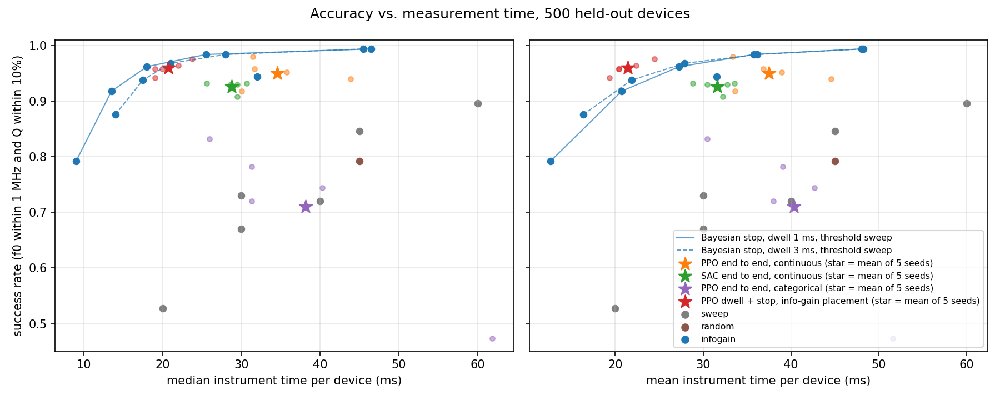
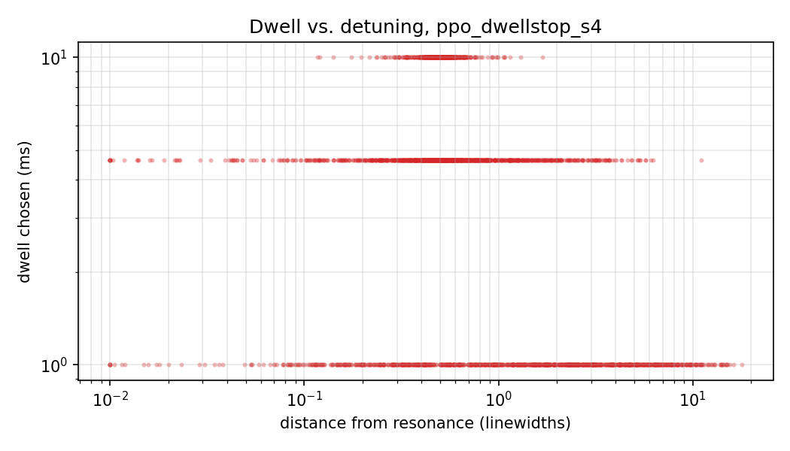
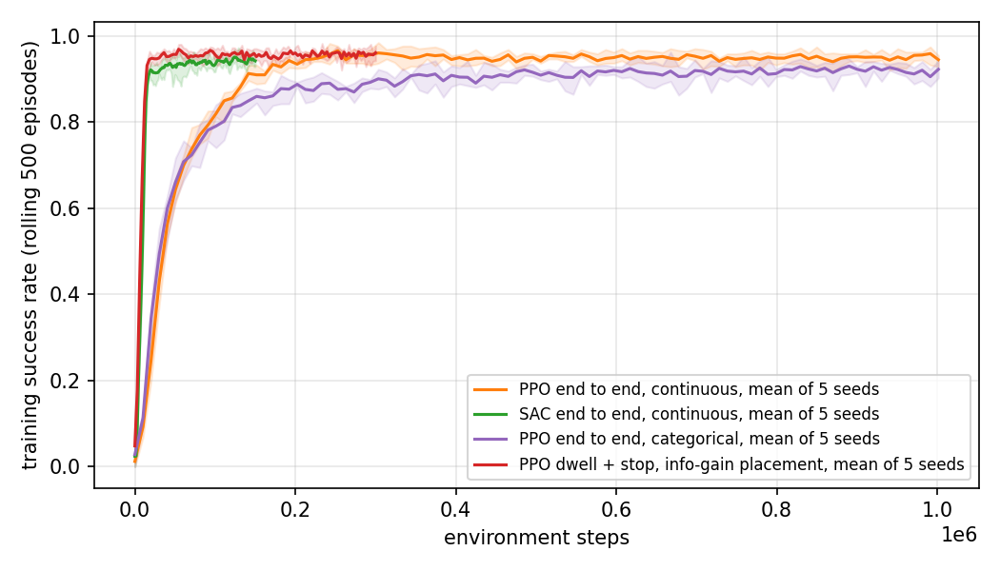

# Adaptive measurement scheduling with reinforcement learning

An agent learns to characterise an unknown RF resonator with as little
instrument time as possible: at every step it chooses **how long to dwell on
the next reading and whether it has seen enough to stop**, while the next
frequency is picked by Bayesian experimental design. Agents are trained with
PPO and SAC (Stable-Baselines3) in a custom Gymnasium environment and compared
against the instrument's default sweep and a Bayesian stopping rule, on 500
devices training never saw.

## The problem

A resonator's transmission is a Lorentzian peak at an unknown centre
frequency `f0` with an unknown quality factor `Q`. The -3 dB linewidth is
`f0 / Q`, so a high-Q device occupies a sliver of the 200 MHz band. Each
reading is noisy; dwelling longer averages the noise down as `1/sqrt(dwell)`
but costs time, and every retune costs 0.5 ms of settling on top.

A run counts as a success only if the reported `f0` is within **1 MHz** and
the reported `Q` within **10 %**. The instrument default, an even sweep at a
fixed dwell, spends most of its time far from the peak, where every reading
is close to zero and tells you little.

This is the same question as adaptive stopping for repeated LLM sampling
(Huang, Ma and Zhou, *Optimal Bayesian Stopping for Efficient Inference of
Consistent LLM Answers*, arXiv:2602.05395): keep paying for samples only while
they are still changing the answer. Here the samples are instrument readings
and the agent also gets to choose *where* to take them.

## Method

**Belief state.** The agent never sees the device. It sees an exact Bayesian
posterior over `(f0, log Q)` kept on a 201 x 61 grid
([`meas_rl/belief.py`](meas_rl/belief.py)), updated after every reading. The
observation is the posterior mean, spread and entropy, the time and step
budget used, and the last reading.

**Environment** ([`meas_rl/env.py`](meas_rl/env.py)). Registered as
`AdaptiveMeasure-v0` (continuous actions), `AdaptiveMeasureDiscrete-v0` and
`AdaptiveMeasureDwellStop-v0`. Reward: `-0.05` per ms of instrument time,
`+10` for a successful report, `-10` for a miss. Episodes end when the agent
stops or after 40 measurements or 60 ms, and both kinds of ending are
terminations (see *What went wrong first*).

**Reward shaping.** Sparse terminal reward makes early training slow, so each
reading also earns potential-based shaping with potential
`Phi(s) = -0.2 * entropy(s)` and `Phi = 0` at the terminal state (Ng, Harada
and Russell, 1999). It pays for information as soon as it arrives, yet sums
to the same constant over every episode, so it cannot change which policy is
optimal. `tests/test_env.py` checks that invariant numerically.

**Agents.** Four families, five seeds each, all Stable-Baselines3
([`configs/`](configs)):

| name | algorithm | the agent chooses | action space |
|---|---|---|---|
| `ppo_dwellstop` (main) | PPO | dwell, stop | `MultiDiscrete([7, 2])`; frequency by expected information gain |
| `ppo_discrete` | PPO | frequency, dwell, stop | `MultiDiscrete([161, 7, 2])` |
| `ppo` | PPO | frequency, dwell, stop | `Box([-1, 1]^3)` |
| `sac` | SAC | frequency, dwell, stop | `Box([-1, 1]^3)` |

The main agent splits the problem along the line where a principled answer
already exists. Choosing the most informative frequency given a posterior is
classic Bayesian experimental design, and expected information gain solves it
well; asking a small network to rediscover it from reward is wasted effort.
How long to integrate and when the answer is good enough are the cost
trade-offs a fixed threshold handles poorly, and that is what RL learns. The
three end-to-end agents are kept as the comparison.

**Baselines** ([`meas_rl/baselines.py`](meas_rl/baselines.py)).

* *Sweep*: even grid across the band at a fixed dwell, the instrument default.
* *Random*: random frequencies at a fixed dwell.
* *Info-gain + Bayesian stop*: measure where the expected information gain
  `0.5 log(1 + Var_post[model(f)] / sigma^2)` is largest, and stop once the
  posterior standard deviation is below 0.3 MHz on `f0` and 0.04 on `log Q`.

## Results

500 devices drawn from seeds training never used, deterministic policies,
every method on the same devices in the same order. "Return" is the quantity
the agents are trained on: `+10` per success, `-10` per miss, `-0.05` per ms.
Learned agents are mean ± standard deviation over five seeds. Full numbers
for all 38 methods are in [`results/eval.json`](results/eval.json).

| method | success | mean time (ms) | 90th pct time (ms) | ran out of budget | return |
|---|---|---|---|---|---|
| **PPO dwell + stop** (main) | **96.0 % ± 1.1** | **21.4 ± 1.8** | **29.7** | **0 %** | **8.12 ± 0.14** |
| Bayesian stop, best of 11 settings (dwell 3 ms, 0.4 MHz / 0.05) | 96.8 % | 27.9 | 56.0 | 9.0 % | 7.97 |
| Bayesian stop, dwell 1 ms, 0.3 MHz / 0.04 | 98.4 % | 35.8 | 60.0 | 26.6 % | 7.89 |
| PPO end to end, continuous | 95.0 % ± 2.0 | 37.5 ± 4.1 | 61.1 | 16.2 % | 7.12 ± 0.49 |
| SAC end to end, continuous | 92.6 % ± 0.9 | 31.6 ± 1.7 | 49.6 | 5.1 % | 6.95 ± 0.22 |
| PPO end to end, categorical | 71.0 % ± 12.4 | 40.4 ± 6.9 | 63.2 | 33.4 % | 2.19 ± 2.80 |
| Sweep, 40 points at 1 ms (instrument default) | 89.6 % | 60.0 | 60.0 | 100 % | 4.92 |
| Random, 30 points at 1 ms | 79.2 % | 45.0 | 45.0 | 0 % | 3.59 |



**Against the instrument default**, the main agent is 6.4 points more
accurate in 2.8 times less instrument time.

**Against the Bayesian stopping rule**, the median time is about the same
(left panel above), but the rule has a long tail: on hard devices it keeps
measuring until the budget runs out, on 9 % of devices at its best-scoring
setting and up to 43 % at the tightest. The agent never runs out. At
comparable accuracy (96.0 % against 96.8 %) its mean time is 23 % lower and
its 90th percentile 47 % lower (right panel), and four of its five seeds earn
a higher return than every one of the 11 threshold settings.
That is the part a fixed threshold cannot express: when a device is not
converging, more readings are not worth their cost.

**Where it spends the time.** Nobody told the agent to vary dwell. It learned
to take 1 ms readings while it is still searching, out to 20 linewidths from
the resonance, and to switch to 4.6 ms and 10 ms only within about one
linewidth of the peak, where averaging pays:



**End to end is harder.** Letting the agent also pick the frequency works
with continuous actions (PPO 95.0 %, SAC 92.6 %) but takes 48 % to 75 % more
instrument time than the split agent, because placement has to be
rediscovered from reward.
The categorical end-to-end agent is the least stable: one seed of five never
got past 47 %.



## What went wrong first

The first round of training produced agents that all did the same thing:
dwell for the maximum 10 ms, take six readings, and let the 60 ms budget end
the episode. None ever chose to stop. They were accurate (PPO hit 97 % on
held-out devices) and slow (63 ms, against 25 ms for the Bayesian baseline).

Four plausible explanations, each checked and each wrong as the root cause:

1. **Saturated Gaussian actions.** The dwell mean had drifted to about 3 and
   the stop mean to about -2.5, far outside the `[-1, 1]` action bound, so
   every sample clipped to the same action. Real, and it still hurts the
   continuous PPO agent, but switching to categorical heads changed nothing.
2. **Stop probability collapsing early.** Stopping at step 0 is almost always
   a miss, so `P(stop)` could be driven to zero before stopping was ever
   useful. Entropy bonuses of 0.01 and 0.03 changed nothing.
3. **Belief summary too thin for search.** Mean and spread cannot represent a
   multimodal posterior. Feeding the 40-bin `f0` marginal changed nothing.
4. **Placement too hard to learn end to end.** Handing placement to expected
   information gain, so the agent only chose dwell and stop, changed nothing.

What found it was scoring the hand-written stopping rule under the same
reward: about 10.1 per episode, against 5.5 for the learned policy. A policy
that much better, reachable with a 7 x 2 action space, should not be missed,
so the learner had to be seeing different rewards from the ones the
environment paid. It was: budget exhaustion was flagged `truncated`, and
Stable-Baselines3 treats truncation as a time limit on an ongoing task and
adds `gamma * V(s_final)` to the last reward. The report had already been
scored, so riding the budget collected the success bonus twice. Flagging it
as a termination fixed every agent at once.
`tests/test_env.py::test_sb3_does_not_bootstrap_a_budget_stop` guards against
it coming back, and the pre-fix numbers are kept in
[`results/pre_fix_runs.json`](results/pre_fix_runs.json).

## Reproduce

```bash
python -m venv .venv && source .venv/bin/activate
pip install -r requirements.txt
python -m pytest -q                       # 18 tests, a few seconds
for c in ppo_dwellstop ppo_discrete ppo sac; do
  for s in 0 1 2 3 4; do
    python scripts/train.py --config configs/$c.yaml --seed $s
  done
done
python scripts/evaluate.py                # writes results/
```

Trained models are committed under `results/models/`, so
`python scripts/evaluate.py` reproduces every number below without training.

Every run is seeded (environment, policy initialisation and evaluation
devices), dependency versions are pinned, and CI runs the test suite on every
push. Evaluation devices come from seeds 100000 and up, a range training never
draws from, and every method sees the same 500 devices in the same order.

## Tests

* the forward model against closed form (peak height, half-power points,
  square-root noise law);
* the posterior is normalised, starts at maximum entropy, and concentrates on
  the true device;
* `gymnasium.utils.env_checker` passes and the registered id builds;
* identical seed and actions give bitwise-identical trajectories;
* shaping sums to the same constant under different policies;
* running out of budget is a termination, and Stable-Baselines3 does not
  bootstrap it (regression tests for the bug described above);
* the categorical and dwell-and-stop action modes decode correctly, and
  dwell-and-stop measures exactly where information gain says to;
* the strongest baseline still solves the task (regression guard).

## Limitations and next steps

* **A simulator, not an instrument.** The device is a single ideal Lorentzian
  with known amplitude and Gaussian noise. Real VNA data has baseline ripple,
  drift and coupled modes, and amplitude would be a third unknown.
* **Two unknowns.** The exact grid posterior is what makes the belief cheap
  and trustworthy here; three or more unknowns need a particle filter or a
  learned amortised posterior.
* **One price on time.** The agent learns the trade-off at `0.05` reward per
  ms. A different cost would need retraining, or the cost could be made part
  of the observation so one policy covers a range of them.
* **Next:** fit amplitude as well; multi-resonance and multi-port S-parameter
  devices; replay recorded measurements through scikit-rf; and reuse the same
  split, physics-based placement plus a learned dwell and stop policy, for
  closed-loop RF tuning.
